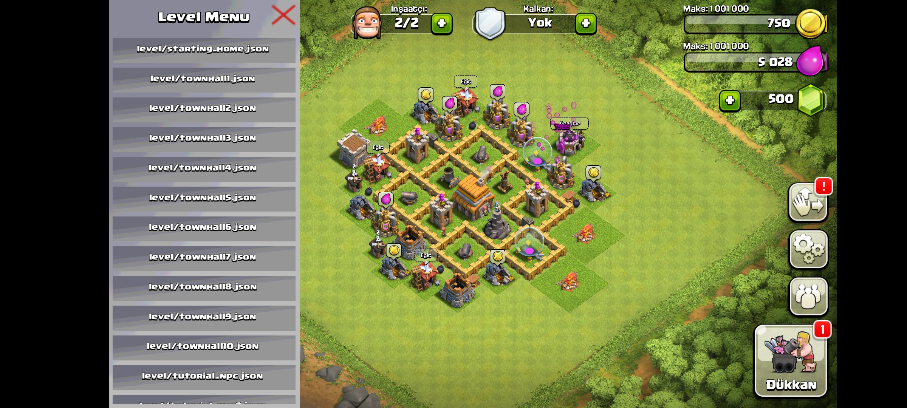
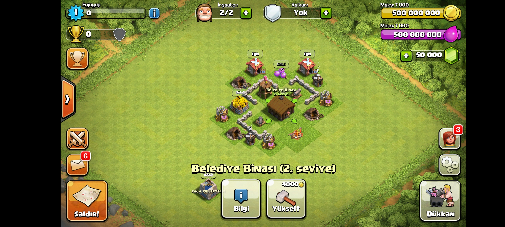
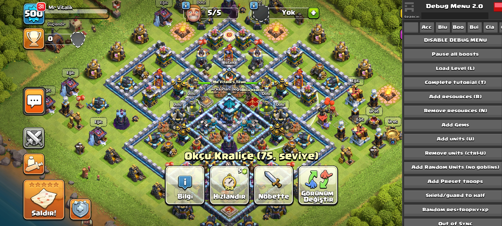
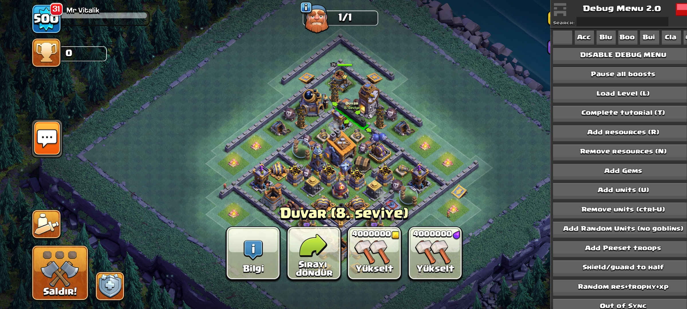
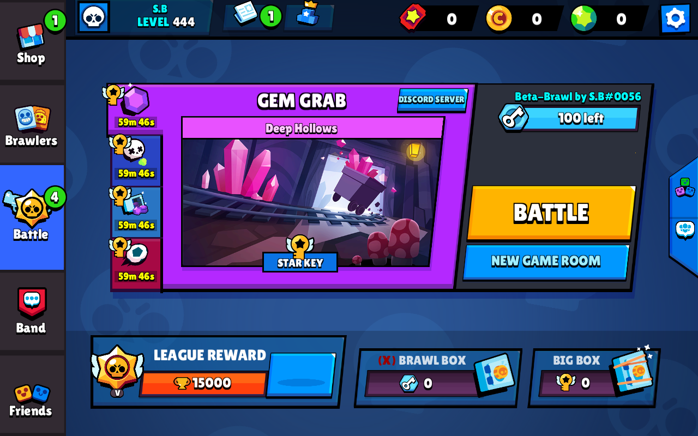
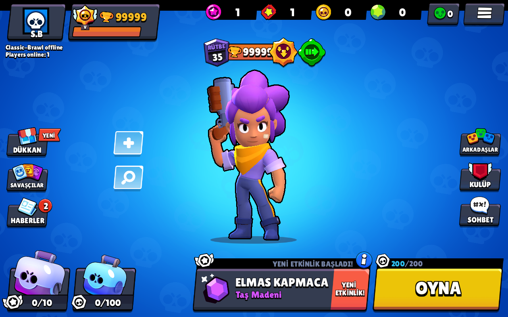
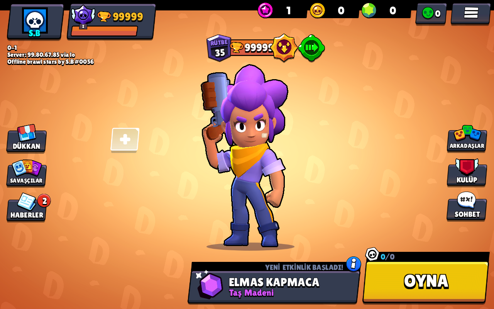

# SupercellFans-Offline-MOD
## Description

- The purpose of this repository is to play old versions and relive nostalgic moments without servers (no data leaves your device and you don't need any host).

- First, I should add that this repository was not created with the intention of harming Supercell in any way. Remember that these mods are not cheats. These mods never connect to Supercell servers and no account transfers are made to any server.

Those who create mods:

[Vitalik Strashnov](https://github.com/VitalikObject)

[Magich](https://github.com/NotHuza)

[MeteHun](https://github.com/Enjoyop2)

[Peterson](https://github.com/PeterHackz)

|Game|Version|Processor|Owner|UseFrida|İmage|
| -- | -- | -- | -- | -- | -- |
| BB | [16.24](https://www.mediafire.com/file/2503r9ns5cyjmv7/Boom+Beach+v16.24.apk/file) | armeabi-v7a | Magich | false | null |
| CoC | [5.2.4](https://drive.google.com/file/d/14SkYm4vEp2Lsr3YKm3qjzoL7Mo4vSij2) | armeabi-v7a | Mr Vitalik & MeteHun | true |  |
| CoC | [7.1.1](https://drive.google.com/file/d/1--NJDWCxf5vwkO4bEW4N-k3guQrpTup1) | armeabi-v7a | MeteHun | false |  |
| CoC | [13.369.18](https://drive.google.com/file/d/1DYXvmCByB2biZ_9wkcLdY-SNuKdu8Ma4) | armeabi-v7a | Mr Vitalik | true |   |
| BS | [11.112](https://www.mediafire.com/file/g6zo96etrdn3z3s/BetaBrawl.apk/file?dkey=kqyddkwowah&r=1980) | armeabi-v7a | Peterson | true |  |
| BS | [26.184](https://www.mediafire.com/file/jo2jldzbx0heis0/ClassicBrawl-Offline.signed.apk/file) | armeabi-v7a | Peterson | true |  |
| BS | [29.258](https://www.mediafire.com/file/8sqpv4d3iupl6pc/BrawlStars-v29-Offline.apk/file) | armeabi-v7a | Peterson | true |  |

## 📜 Legal & Disclaimer

This repository is created in accordance with **Supercell's Fan Content Policy**.

🔗 https://supercell.com/en/fan-content-policy/

- This project is **not affiliated with, endorsed, sponsored, or approved by Supercell**.
- All game assets belong to their respective owners.
- This repository is intended for **non-commercial fan and educational use only**.

---

---
## ⭐ Support
If you found this repository helpful, you might consider giving it a star ⭐ to show your support.
---
